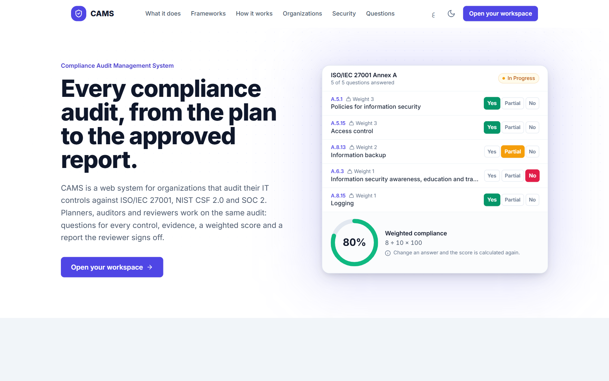
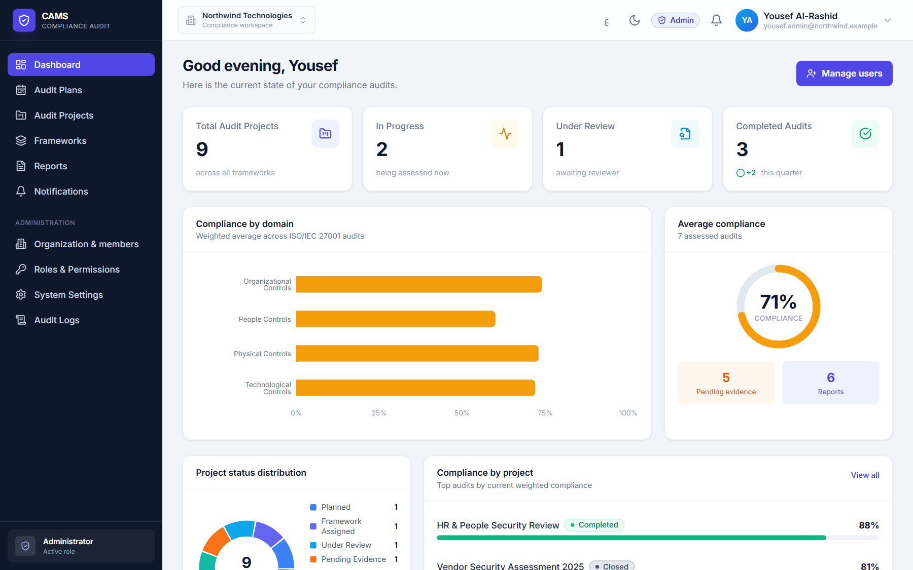
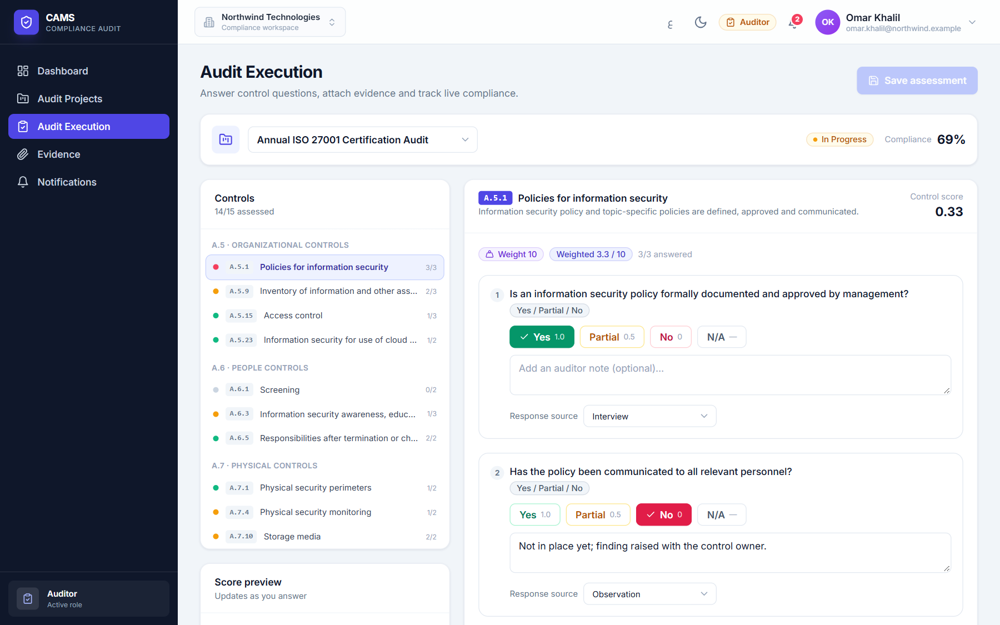
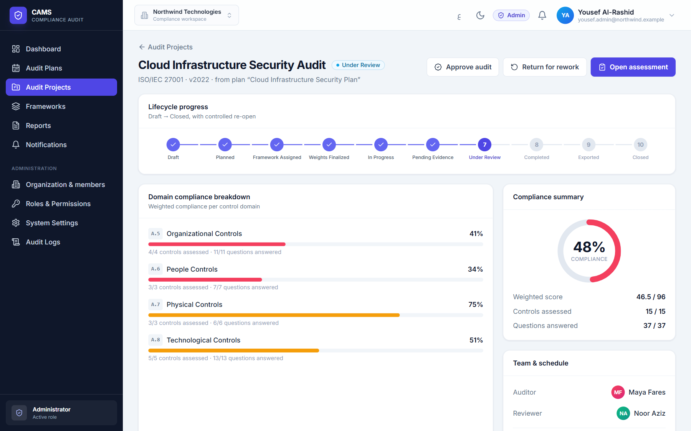
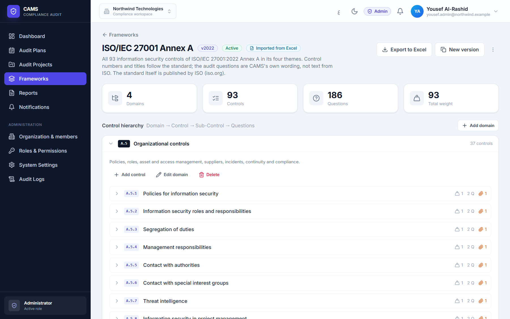
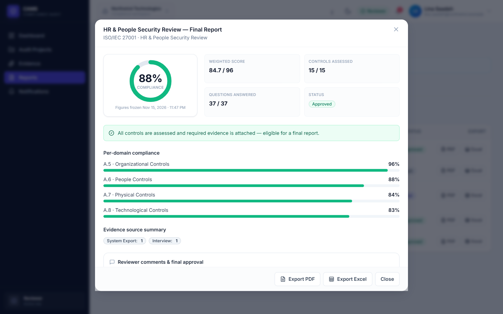
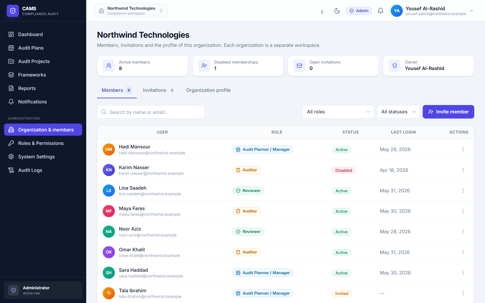
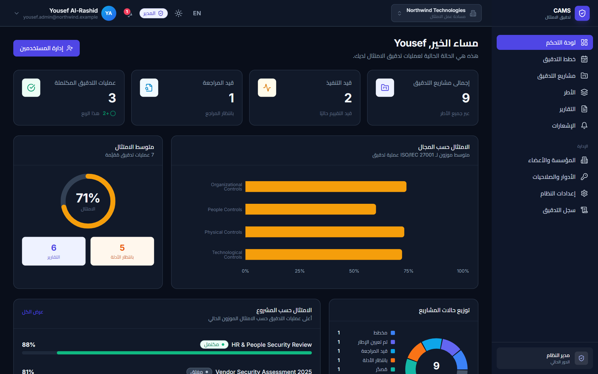
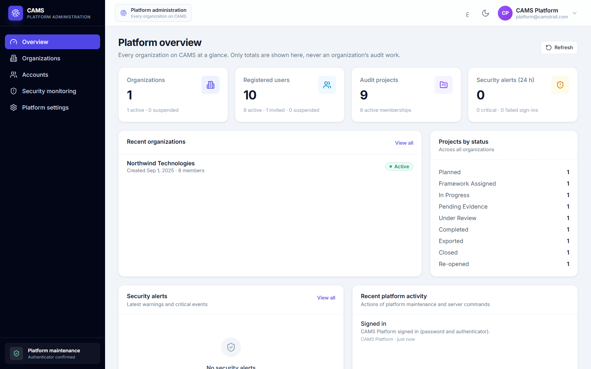
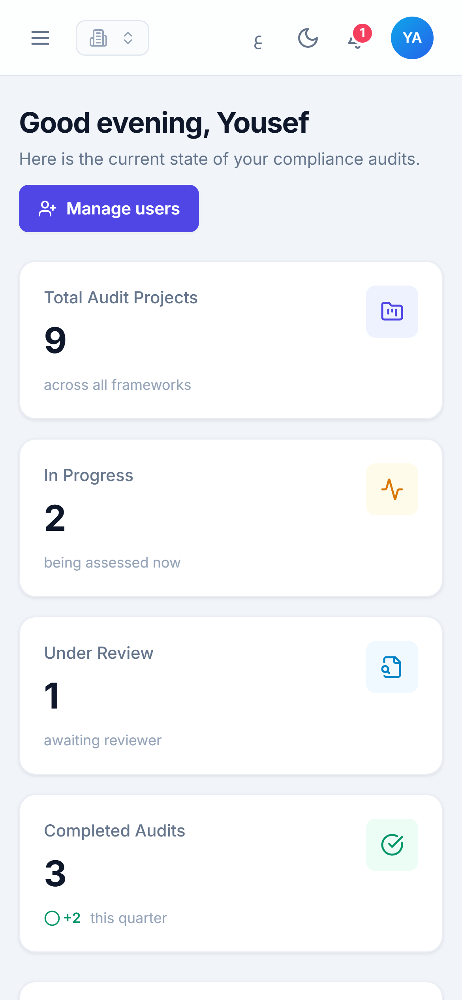

# CAMS · Compliance Audit Management System

**Live website: [camstrail.com](https://camstrail.com)** · [About CAMS](https://camstrail.com/about) · [Create an organization](https://camstrail.com/signup)

CAMS is a web system for organizations that audit their IT controls against **ISO/IEC 27001**, **NIST CSF 2.0** and **SOC 2**. Planners, auditors and reviewers work on the same audit in one place: questions for every control, evidence attached to the control it proves, a weighted compliance score that updates as you answer, and a final report that the reviewer approves and exports to PDF or Excel.

It is our graduation project at **Palestine Technical University – Kadoorie**, and it is running online, not just a prototype.

> This repository only presents the project. The source code and the database are private.

---

## Why we built it

A lot of compliance audits are still done with spreadsheets, Word files and email. Evidence loses its link to the control, scores are calculated by hand, nobody is sure which version of a file is the right one, and the final report takes days to put together.

CAMS keeps the whole audit together, from the plan to the approved report, and records who did what and when.

## What it does

- **Audit plans and projects.** A plan sets the scope, objectives and dates. After it is approved, audit projects are created under it, each with its auditor and reviewer.
- **Questions for every control.** The auditor answers Yes, Partial, No or N/A, adds notes and says where the answer came from (interview, observation, document, system log…).
- **Weighted compliance score.** Every control has a weight, and the score of the project and of each domain is calculated again with every answer.
- **Evidence with a SHA-256 fingerprint.** Files are uploaded to the control they prove. Each file gets a hash, so anyone on the project can check later that the stored file was not changed. The reviewer verifies or rejects every file.
- **Review and approval.** Nobody validates evidence they uploaded or approves a report they created. A report keeps a frozen copy of the figures, the answers and the evidence list, so the exported file always matches the approved report.
- **PDF and Excel reports**, including Arabic text in the PDF.
- **Frameworks.** Three complete frameworks are ready on day one. You can also build your own framework on screen or import it from an Excel template, and export any framework back to Excel.
- **Notifications** in the system and by email (assignments, review requests, approvals, re-opened audits), plus a weekly summary for administrators and planners.
- **An audit log nobody can edit.** Every change, status move and export is recorded. Entries can be added, never changed or deleted.
- **Many organizations.** Anyone can sign up and get their own organization. Each organization is completely separate, and one person can belong to several organizations with a different role in each.
- **English and Arabic** (full right-to-left layout), **light and dark** themes, and it works on phones.

## How an audit moves

An audit project goes through ten statuses. The system decides who can move it forward and what has to be done first, and every move is recorded.

**Draft → Planned → Framework Assigned → Weights Finalized → In Progress → Pending Evidence → Under Review → Completed → Exported → Closed**

Once the weights are finalized, the framework structure is locked, so the audit is always scored against something that cannot change under it. Answers are locked when the audit goes to review. A finished audit can be re-opened, but only with a written reason that stays in the history.

## Roles

| Role | What they do |
|------|--------------|
| **Administrator** | Invites members and sets their roles, manages the organization settings, reads the audit log, and has every permission of the other roles |
| **Audit Planner / Manager** | Writes audit plans, creates projects under approved plans, chooses the framework and sets the control weights, assigns the auditor and reviewer |
| **Auditor** | Answers the questions of each control, adds notes, uploads evidence. Sees only the projects assigned to them |
| **Reviewer** | Verifies or rejects evidence, approves the audit and finalizes the report, exports reports |

The people who run the platform have a separate administration area. They sign in with an authenticator app as a mandatory second step, and they can see organizations, accounts and totals, but never project names, answers, evidence or reports.

## Frameworks included

| Framework | Content |
|-----------|---------|
| ISO/IEC 27001:2022 Annex A | 4 themes, 93 controls, 186 questions |
| NIST Cybersecurity Framework 2.0 | 6 functions, 22 categories, 106 subcategories |
| SOC 2 Trust Services Criteria (2017, revised 2022) | 61 criteria, 122 questions |

For ISO/IEC 27001 the control numbers and titles follow the standard, and we wrote the audit questions ourselves. NIST CSF 2.0 uses NIST's own Core, with one question for each subcategory. For SOC 2 the criterion numbers follow the AICPA criteria, and we wrote the titles and questions.

## How the score is calculated

- Yes = 1, Partial = 0.5, No = 0, and N/A is left out
- Control score = the average of its answered questions
- **Compliance % = Σ (control score × control weight) ÷ Σ weights × 100**

The same calculation gives the score of each domain and of the whole project.

## Security

- Every read and every change is limited to the organization you are working in. A record from another organization is answered as "not found", so even its existence is not revealed.
- Your role and permissions are checked on the server with every request, so a role change or a disabled membership works immediately.
- Passwords are stored as bcrypt hashes. Nobody can set your password or change your email for you, not even your administrator.
- Repeated wrong passwords lock sign-in for a while, and sign-ups, invitations and reset links are limited.
- The audit log and the security trail are append-only, and the database itself refuses to edit or delete them.
- The whole site runs over HTTPS.

## Screenshots

**Dashboard**

**Audit execution:** answering the questions of each control with a live score

**Audit project:** lifecycle, domain breakdown and team

**Framework:** ISO/IEC 27001:2022 Annex A with its domains, controls and questions

**Approved final report**, ready to export to PDF or Excel

**Organization and members**

**Arabic interface in dark mode**

**Platform administration**

**On a phone**

*All screenshots use a fictional sample company (Northwind Technologies) and invented people.*

## Built with

- **Frontend:** React, TypeScript, Vite, Tailwind CSS, Recharts
- **Backend:** Node.js, Express, TypeScript
- **Database:** MySQL / MariaDB
- **Hosting:** Ubuntu cloud server, nginx, HTTPS with Let's Encrypt, email through Resend
- **Testing:** 184 automated API tests with Vitest

## Team

Graduation project, Palestine Technical University – Kadoorie

- **Ibraheem Mahmoud**
- **Baraa Rasmi**
- **Aktham Maher**

Supervisor: **Dr. Fadi Khalil Mohammad**

---

## بالعربي

**CAMS** نظام ويب لإدارة تدقيق الامتثال لأنظمة تكنولوجيا المعلومات حسب معايير **ISO/IEC 27001** و **NIST CSF 2.0** و **SOC 2**. بيشتغل فيه المخطط والمدقق والمراجع على نفس عملية التدقيق: أسئلة لكل ضابط، أدلة مربوطة بالضابط مع بصمة SHA-256، نسبة امتثال موزونة بتنحسب تلقائياً، وتقرير نهائي بيعتمده المراجع وبينصدّر PDF أو Excel.

النظام بيدعم أكثر من مؤسسة، كل مؤسسة معزولة عن الثانية، وبيشتغل بالعربي والإنجليزي، بالوضع الفاتح والداكن، وعلى التلفون.

مشروع تخرج في جامعة فلسطين التقنية – خضوري. النظام شغّال على: **[camstrail.com](https://camstrail.com)**

---

© 2026 Ibraheem Mahmoud, Baraa Rasmi and Aktham Maher. All rights reserved.
